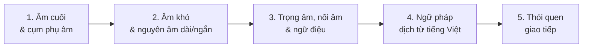

# Sửa lỗi nói tiếng Anh của người Việt

:::info[Vì sao người Việt hay mắc cùng một kiểu lỗi?]
Không phải vì bạn "kém", mà vì **bộ não đang nói tiếng Anh bằng luật của tiếng Việt**:

| Tiếng Việt | Tiếng Anh | Hậu quả khi nói |
|---|---|---|
| Đơn âm, gần như không có phụ âm cuối kép | Nhiều âm cuối và cụm phụ âm (*asked* /æskt/, *texts* /teksts/) | Nuốt âm cuối, nói "ách" thay cho *asked* |
| Có **thanh điệu** – cao độ thay đổi nghĩa của từ | Có **trọng âm và ngữ điệu** – cao độ thể hiện ý và cảm xúc | Nói đều đều, mỗi từ một "dấu", nghe như robot |
| Mỗi âm tiết dài bằng nhau | Âm nhấn dài, âm không nhấn đọc lướt | Đọc rõ từng chữ → chậm, khó nghe |
| Động từ không đổi dạng | Chia thì, thêm *-s, -ed* | "Yesterday I go…", "She like…" |
| Hỏi tuổi, lương, chuyện gia đình là quan tâm | Đó là chuyện riêng tư | Người nghe thấy khó chịu dù bạn có ý tốt |

Trang này gom các lỗi đó thành **4 nhóm**. Mỗi tuần chỉ sửa **một lỗi**: nghe ví dụ 🔊, tự ghi âm, so sánh, rồi làm bài kiểm tra cuối trang.
:::

## 1. Âm cuối và cụm phụ âm

Đây là lỗi **phổ biến nhất** và ảnh hưởng nhiều nhất tới việc người nghe có hiểu bạn hay không. Tiếng Việt kết thúc âm tiết bằng *c, ch, t, p, m, n, ng, nh*, và các âm này **không bật hơi**. Tiếng Anh thì **phải nghe thấy** âm cuối, vì nó mang nghĩa: số nhiều, ngôi thứ ba, thì quá khứ.

### 1.1 Bỏ âm cuối làm đổi nghĩa

<VocabList>

| Từ | Phiên âm | Nếu bỏ âm cuối, nghe thành | Câu luyện |
|---|---|---|---|
| wife | /waɪf/ | why /waɪ/ | My wife works in a bank. |
| white | /waɪt/ | why /waɪ/ | I bought a white shirt. |
| rice | /raɪs/ | rye, "rai" | We eat rice every day. |
| five | /faɪv/ | "phai" | I have five cats. |
| bike | /baɪk/ | buy /baɪ/ | I ride my bike to work. |
| card | /kɑːd/ | car /kɑː/ | Can I pay by card? |
| needs | /niːdz/ | need /niːd/ | She needs more time. |
| worked | /wɜːkt/ | work /wɜːk/ | I worked late last night. |

</VocabList>

:::tip[Cách sửa]
- **Phóng đại** âm cuối lúc mới luyện: *wife* → "oai-**ffff**", *bike* → "bai-**k**" (bật nhẹ hơi ở cuối).
- Tập trung vào **-s** và **-ed**: thiếu hai âm này, người nghe sẽ hiểu sai thì và sai số lượng.
- Đặt tay trước miệng: âm /p/, /t/, /k/ cuối phải cảm thấy **một luồng hơi nhỏ**.
:::

### 1.2 Ba cách đọc đuôi -ed và -s

| Đuôi | Đọc là | Khi từ tận cùng bằng | Ví dụ |
|---|---|---|---|
| **-ed** | /t/ | âm vô thanh /p, k, f, s, ʃ, tʃ/ | stop**ped** /stɒpt/, ask**ed** /ɑːskt/, watch**ed** /wɒtʃt/ |
| | /d/ | âm hữu thanh còn lại | play**ed** /pleɪd/, liv**ed** /lɪvd/ |
| | /ɪd/ | /t/ hoặc /d/ | want**ed** /ˈwɒntɪd/, need**ed** /ˈniːdɪd/ |
| **-s / -es** | /s/ | /p, t, k, f, θ/ | book**s**, cat**s**, laugh**s** |
| | /ɪz/ | /s, z, ʃ, tʃ, dʒ/ | bus**es**, watch**es**, chang**es** |
| | /z/ | âm còn lại | play**s**, dog**s**, go**es** |

:::warning[Lỗi hay gặp]
Đọc *-ed* thành một âm tiết riêng ở mọi từ: *asked* → "át-két", *worked* → "uốc-két". Chỉ khi từ tận cùng bằng /t/ hoặc /d/ thì *-ed* mới thành âm tiết riêng /ɪd/.
:::

### 1.3 Chêm âm "ơ" vào giữa cụm phụ âm

Tiếng Việt không có cụm phụ âm như *str-, spl-, -sks*, nên ta hay chèn thêm "ơ": *street* → "sơ-tơ-rít", *school* → "sờ-cun".

<VocabList>

| Từ | Phiên âm | Lỗi hay gặp | Câu luyện |
|---|---|---|---|
| street | /striːt/ | "sơ-tơ-rít" | I live on a quiet street. |
| school | /skuːl/ | "sờ-cun" | My son walks to school. |
| spring | /sprɪŋ/ | "sơ-pơ-ring" | Spring is my favourite season. |
| asked | /ɑːskt/ | "át-sơ-kéc" | She asked me a question. |
| texts | /teksts/ | "tếch" | He sends me ten texts a day. |
| months | /mʌnθs/ | "măn" | I've lived here for six months. |

</VocabList>

:::tip[Cách sửa: luyện ngược từ cuối lên]
*asked* → luyện **-kt** → **-skt** → **a-skt**. Đọc chậm, **không mở miệng** giữa các phụ âm, rồi tăng tốc dần.
:::

## 2. Những âm tiếng Việt không có

### 2.1 Phụ âm dễ nhầm

<VocabList>

| Từ | Phiên âm | Dễ nhầm với | Câu luyện |
|---|---|---|---|
| think | /θɪŋk/ | sink /sɪŋk/, "thinh" | I think it's a good idea. |
| three | /θriː/ | tree /triː/ | I have three brothers. |
| this | /ðɪs/ | "đít" /dɪs/ | This is my office. |
| she | /ʃiː/ | see /siː/ | She is my manager. |
| ship | /ʃɪp/ | sip /sɪp/ | The ship left the port. |
| zoo | /zuː/ | "giu" | We took the kids to the zoo. |
| rice | /raɪs/ | "zai" (giọng miền Bắc) | Do you want more rice? |
| light | /laɪt/ | night /naɪt/ | Turn off the light, please. |
| very | /ˈveri/ | berry /ˈberi/ | It's very hot today. |
| pleasure | /ˈpleʒə/ | "pờ-le-sờ" | It's a pleasure to meet you. |

</VocabList>

| Âm | Đặt lưỡi / môi thế nào |
|---|---|
| /θ/ *think*, /ð/ *this* | Đầu lưỡi đặt **giữa hai hàm răng**, thổi hơi ra. /θ/ không rung cổ, /ð/ rung cổ. |
| /ʃ/ *she* | Môi **tròn và chu ra**, lưỡi lùi về sau; khác /s/ là môi dẹt và lưỡi sát răng. |
| /z/ *zoo* | Như /s/ nhưng **rung cổ họng** (đặt tay lên cổ để kiểm tra), không phải "gi" tiếng Việt. |
| /r/ *rice* | Cong lưỡi lên nhưng **không chạm** vòm miệng, môi hơi tròn; không rung như "r" tiếng Việt, cũng không phải "z". |
| /l/ và /n/ | /l/: hơi đi **hai bên lưỡi**; /n/: hơi đi qua **mũi** (bịt mũi lại thì không nói được /n/). |

### 2.2 Nguyên âm dài – ngắn

Tiếng Việt phân biệt nghĩa bằng thanh điệu, còn tiếng Anh phân biệt bằng **độ dài và độ mở của nguyên âm**.

<VocabList>

| Từ | Phiên âm | Cặp với | Câu luyện |
|---|---|---|---|
| sheep | /ʃiːp/ | ship /ʃɪp/ | There are sheep on the hill. |
| leave | /liːv/ | live /lɪv/ | I leave home at seven. |
| full | /fʊl/ | fool /fuːl/ | I'm full, thank you. |
| bad | /bæd/ | bed /bed/ | It's not a bad idea. |
| man | /mæn/ | men /men/ | That man is my uncle. |
| work | /wɜːk/ | walk /wɔːk/ | I work from home on Fridays. |

</VocabList>

:::tip[Cách sửa]
- /iː/, /uː/, /ɜː/ có dấu **ː** thì **kéo dài** gấp đôi; /ɪ/, /ʊ/ ngắn và lỏng.
- /æ/ (*bad, man*): mở miệng **rộng như khi nói "a" nhưng kéo miệng sang hai bên**, không phải "e" hay "a" tiếng Việt.
:::

## 3. Trọng âm, nối âm và ngữ điệu

### 3.1 Trọng âm từ

Nhấn sai trọng âm thì dù phát âm từng âm đúng, người nghe vẫn có thể không nhận ra từ đó.

<VocabList>

| Từ | Phiên âm | Hay nhấn sai thành | Câu luyện |
|---|---|---|---|
| hotel | /həʊˈtel/ | **HO**-tel | We stayed at a small hotel. |
| comfortable | /ˈkʌmftəbl/ | com-**FOR**-ta-ble | This chair is very comfortable. |
| develop | /dɪˈveləp/ | **DE**-ve-lop | We develop mobile apps. |
| photography | /fəˈtɒɡrəfi/ | **PHO**-to-gra-phy | I'm interested in photography. |
| vegetable | /ˈvedʒtəbl/ | ve-ge-**TA**-ble | Eat more vegetables. |
| event | /ɪˈvent/ | **E**-vent | The event starts at six. |

</VocabList>

### 3.2 Nói từng chữ tách rời → học cách nối âm

Người Việt thường dừng sau mỗi từ (vì tiếng Việt mỗi chữ là một âm tiết độc lập). Người bản xứ **nối âm cuối với âm đầu của từ sau**.

| Viết | Người Việt hay đọc | Nên đọc |
|---|---|---|
| get up | "ghét / ắp" | ge-**tup** |
| turn off | "tơn / óp" | tur-**noff** |
| an apple | "ăn / áp-pồ" | a-**na**-pple |
| pick it up | "píc / ít / ắp" | pi-**ki**-**tup** |
| want to | "oăn / tu" | **wanna** /ˈwɒnə/ (văn nói) |
| going to | "gâu-ing / tu" | **gonna** /ˈɡʌnə/ (văn nói) |

### 3.3 Dạng yếu: không phải từ nào cũng đọc rõ

Từ chức năng (*to, for, and, can, of, a, the*) thường đọc **lướt** với âm /ə/. Đọc rõ tất cả mọi từ làm câu nói nghe cứng và chậm.

<SpeakText title="Dạng yếu – nghe và nhại lại">

I want **to** /tə/ go **for** /fə/ a walk. – Fish **and** /ən/ chips. – I **can** /kən/ swim. – A cup **of** /əv/ tea.

</SpeakText>

### 3.4 Ngữ điệu: đừng "đặt dấu" lên tiếng Anh

Người Việt hay gắn **thanh sắc hoặc thanh nặng** vào cuối mỗi từ, nên câu nghe gắt hoặc như đang cáu. Tiếng Anh dùng **lên–xuống giọng theo cả câu**:

| Loại câu | Ngữ điệu | Ví dụ |
|---|---|---|
| Câu khẳng định | ↘ xuống cuối câu | I live in Da Nang. ↘ |
| Câu hỏi Wh- | ↘ xuống | Where do you work? ↘ |
| Câu hỏi Yes/No | ↗ lên | Do you like coffee? ↗ |
| Liệt kê | ↗ ↗ ↘ | I like tea ↗, coffee ↗, and juice ↘. |
| Nhấn ý chính | Nhấn mạnh từ mang thông tin mới | I didn't say **she** stole it. (người khác lấy) |

:::tip[Bài luyện ngữ điệu]
Chọn một câu trả lời mẫu bất kỳ trong các chủ đề, **gạch chân 1–2 từ quan trọng nhất** của mỗi câu, rồi đọc to: nhấn mạnh từ đó, đọc lướt phần còn lại. Ghi âm và so sánh với 🔊.
:::

## 4. Ngữ pháp "dịch từ tiếng Việt"

Lỗi nhóm này đến từ việc **nghĩ bằng tiếng Việt rồi dịch từng chữ**.

| ❌ Câu dịch từng chữ | Câu tiếng Việt gốc | ✅ Câu tự nhiên |
|---|---|---|
| Yesterday I **go** to the cinema. | Hôm qua tôi **đi** xem phim. | Yesterday I **went** to the cinema. |
| She **like** coffee. | Cô ấy thích cà phê. | She **likes** coffee. |
| I **very busy**. | Tôi rất bận. | I**'m** very busy. |
| I **am agree** with you. | Tôi đồng ý với bạn. | I **agree** with you. |
| **In my family have** four people. | Nhà tôi **có** bốn người. | **There are** four people in my family. |
| I **very like** football. | Tôi **rất thích** bóng đá. | I **really like** football. / I like football **a lot**. |
| **Open** the light, please. | **Mở** đèn giúp mình. | **Turn on** the light, please. |
| I'm **boring**. | Tôi chán quá. | I'm **bored**. (*boring* = làm người khác chán) |
| **You like** coffee? / **Why you** late? | Bạn thích cà phê không? | **Do you like** coffee? / **Why are you** late? |
| He gave me some **informations / advices**. | Anh ấy cho tôi vài thông tin. | some **information / advice** (không đếm được) |
| I **play** computer every night. | Tôi **chơi** máy tính. | I **play games / use my computer** every night. |
| Can you **borrow** me your pen? | Cho tôi **mượn** bút. | Can I **borrow** your pen? / Can you **lend** me your pen? |
| I have **ever** been to Hue. | Tôi **đã từng** đến Huế. | I **have been** to Hue. (*ever* chỉ dùng trong câu hỏi/phủ định) |
| My father **is** 50 **years**. | Bố tôi 50 tuổi. | My father is 50 (**years old**). |

### 4.1 Trả lời câu hỏi phủ định: Yes/No ngược với tiếng Việt

Tiếng Việt trả lời theo **ý của người hỏi** (đúng/không đúng). Tiếng Anh trả lời theo **sự thật**: thật sự có thì *Yes*, không có thì *No*.

| Câu hỏi | Sự thật | Người Việt hay trả lời | ✅ Đúng |
|---|---|---|---|
| You **don't** like spicy food? | Tôi không thích | ❌ *Yes.* (= "Đúng vậy") | **No, I don't.** |
| You **didn't** go to the party? | Tôi có đi | ❌ *No, I went.* | **Yes, I did.** |
| Aren't you tired? | Tôi không mệt | ❌ *Yes, I'm not.* | **No, I'm not.** |

:::tip[Mẹo]
Bỏ chữ phủ định trong câu hỏi đi rồi trả lời: *"You don't like spicy food?"* → *"Do you like spicy food?"* → *"No, I don't."*
:::

## 5. Thói quen giao tiếp không hợp với tiếng Anh

Nói đúng ngữ pháp nhưng **sai thói quen văn hoá** vẫn làm người nghe thấy lạ, thậm chí khó chịu. Đây là những thói quen nên bỏ.

### 5.1 Hỏi chuyện riêng tư quá sớm

| ❌ Tránh hỏi người mới quen | Vì sao | ✅ Hỏi thay vào đó |
|---|---|---|
| How old are you? | Tuổi là chuyện riêng, nhất là với phụ nữ và người lớn tuổi | What do you do? / Where are you from? |
| How much is your salary? | Thu nhập là chủ đề rất nhạy cảm | How do you like your job? |
| Are you married? Why not? | Hôn nhân, con cái là chuyện riêng | What do you like doing at weekends? |
| You've gained weight! / You look fat. | Nhận xét ngoại hình bị coi là bất lịch sự | You look great! / I love your jacket. |
| Where are you going? (thay câu chào) | Giống như đang tra hỏi | Hi! How's it going? / How are you doing? |

### 5.2 Khiêm tốn quá mức khi được khen

Người Việt hay chối lời khen để tỏ ra khiêm tốn. Trong tiếng Anh, chối lời khen giống như **bảo người khen nói sai**.

<SpeakText title="Nhận lời khen">

**A:** Your English is really good! **B (❌):** No, no, my English is very bad. **B (✅):** Thank you! I've been practising a lot.

**A:** Great presentation today. **B (❌):** No, it was terrible. **B (✅):** Thanks, I'm glad you liked it.

</SpeakText>

### 5.3 Nói quá thẳng khi nhờ vả, từ chối, không đồng ý

Tiếng Việt dùng *nhé, nha, giúp mình, với* để làm mềm câu. Khi dịch sang tiếng Anh, các từ đệm này bị mất nên câu thành **mệnh lệnh**.

| ❌ Nghe như ra lệnh / thô | ✅ Lịch sự, tự nhiên |
|---|---|
| Give me the report. | **Could you** send me the report, **please**? |
| You must fix this today. | **Would it be possible to** fix this today? |
| You are wrong. | **I see your point, but I think**… / **I'm not sure that's right.** |
| I don't want. / No. | **I'd love to, but** I'm busy tonight. / **Thanks, but I'll pass.** |
| Repeat! / What? | **Sorry, could you say that again?** / **Pardon?** |
| Teacher, I have a question! | **Excuse me, Ms Lan**, I have a question. |

### 5.4 Cách xưng hô

| ❌ Thói quen dịch từ tiếng Việt | ✅ Cách dùng đúng |
|---|---|
| Gọi giáo viên là *Teacher!* | Gọi theo tên: *Ms Hoa, Mr Smith* – hoặc *Excuse me* |
| *Mr Thang* (Mr + **tên**) với người nước ngoài | Mr/Ms + **họ** (*Mr Nguyen*) trong ngữ cảnh trang trọng, hoặc gọi thẳng **tên** (*Thang*) trong công ty |
| Gọi sếp là *Boss!* | Gọi tên: *Hi John* (môi trường quốc tế thường gọi tên kể cả với sếp) |
| *Hey you!* để gọi người lạ | *Excuse me!* |

### 5.5 Im lặng khi nghe và trả lời cụt

Khi người khác nói, người Việt thường **im lặng lắng nghe**; người nói tiếng Anh lại cần **tín hiệu phản hồi** để biết bạn đang theo dõi. Trả lời chỉ *Yes. / No.* cũng làm cuộc trò chuyện "chết".

| Tình huống | Dùng |
|---|---|
| Đang nghe | *Right. · I see. · Really? · Oh, that's interesting. · Uh-huh.* |
| Đồng cảm | *That sounds great! · Oh no, that's terrible. · I know what you mean.* |
| Trả lời rồi hỏi lại | *I'm from Hue. **What about you?*** · *Pretty good, thanks. **And you?*** |

:::warning[Câu học thuộc trong sách giáo khoa]
*"I'm fine, thank you. And you?"* đúng nhưng nghe như học thuộc. Hãy đổi cách trả lời: *Pretty good, thanks!* · *Not bad – a bit tired, actually.* · *Great, I just got back from holiday.*
:::

### 5.6 Từ đệm tiếng Việt và "Vinglish"

| ❌ Thói quen | ✅ Thay bằng |
|---|---|
| Ờ… à… ừm… kéo dài khi suy nghĩ | *Well… · Let me think… · That's a good question.* |
| Thêm *nhé, nha, á* vào câu tiếng Anh | Câu hỏi đuôi hoặc *please*: *It's nice, **isn't it**? · See you tomorrow, **OK**?* |
| *OK OK OK* liên tục | *Sure. · Got it. · Sounds good.* |
| *Same same*, *No have*, *Can can* | *It's similar. · I don't have one. · Yes, I can.* |
| *Very very good* | *Excellent · Fantastic · Really good* |
| Cười khi mắc lỗi hoặc khi xin lỗi | Nói rõ: *Sorry, my mistake.* (cười lúc xin lỗi dễ bị hiểu là không nghiêm túc) |

## 6. Kế hoạch sửa lỗi 4 tuần

| Tuần | Tập trung | Mỗi ngày (15–20 phút) |
|---|---|---|
| 1 | Âm cuối, -s, -ed, cụm phụ âm (mục 1) | Đọc to các bảng 🔊, ghi âm 10 câu luyện, nghe lại, chỉ sửa **âm cuối** |
| 2 | Âm khó và nguyên âm dài/ngắn (mục 2) | Luyện 2 cặp âm mỗi ngày (*ship/sheep, she/see…*), tự đặt 3 câu có cặp đó |
| 3 | Trọng âm, nối âm, ngữ điệu (mục 3) | Shadowing 1 bài mẫu trong các chủ đề, gạch chân từ nhấn trước khi đọc |
| 4 | Ngữ pháp dịch & thói quen giao tiếp (mục 4–5) | Nói 2 phút về một chủ đề, nghe lại và đánh dấu mọi câu "dịch từng chữ"; luyện các mẫu lịch sự ở mục 5 |

:::tip[Một quy tắc quan trọng]
**Mỗi lần luyện chỉ sửa một lỗi.** Vừa nói vừa lo cả âm cuối, ngữ pháp lẫn ngữ điệu sẽ làm bạn cứng lại và mất trôi chảy. Lỗi nào đã thành phản xạ thì chuyển sang lỗi tiếp theo.
:::

## 7. Tự đánh giá sau khi ghi âm

- [ ] Nghe rõ âm cuối, nhất là **-s** và **-ed**.
- [ ] Không chêm "ơ" vào *street, school, asked*.
- [ ] Phân biệt được /θ/ – /s/, /ʃ/ – /s/, /l/ – /n/.
- [ ] Nhấn đúng trọng âm các từ nhiều âm tiết.
- [ ] Nối âm, không ngắt sau mỗi từ.
- [ ] Câu khẳng định xuống giọng, câu hỏi Yes/No lên giọng.
- [ ] Chia thì đúng (đặc biệt quá khứ), có **-s** ngôi thứ ba.
- [ ] Không dùng *very like, I am agree, In my family have…*
- [ ] Có phản hồi khi nghe, trả lời xong hỏi lại.
- [ ] Nhờ vả, từ chối, phản đối bằng câu lịch sự.

## 8. Bài kiểm tra theo cấp độ (30 câu)

Ba cấp độ, mỗi cấp 10 câu: **Dễ** (nhận ra câu đúng), **Trung bình** (chọn cách nói tự nhiên, lịch sự), **Khó** (phát âm, trọng âm, cách trả lời câu hỏi phủ định).

import quizLoiNoi from '@site/src/data/quizzes/sua-loi-noi-nguoi-viet.json';
import LevelQuiz from '@site/src/components/LevelQuiz';

<LevelQuiz topic="SUA-LOI-NOI" data={quizLoiNoi} />

Xem thêm: [Phương pháp luyện nói](./phuong-phap.mdx) · [Nói theo dàn ý](./dan-y.mdx)
